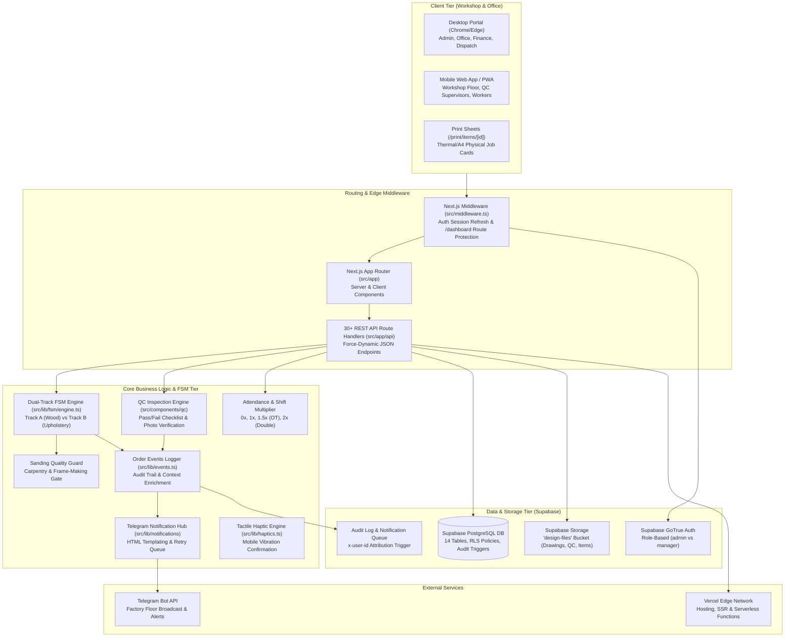
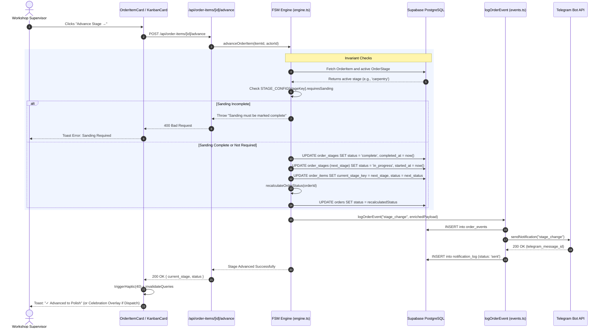
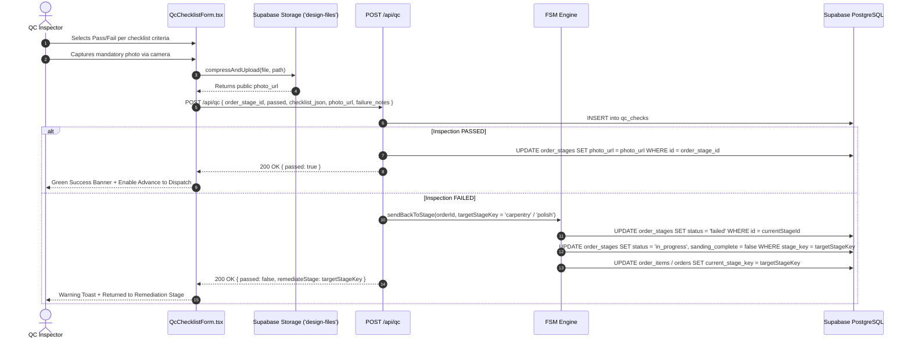
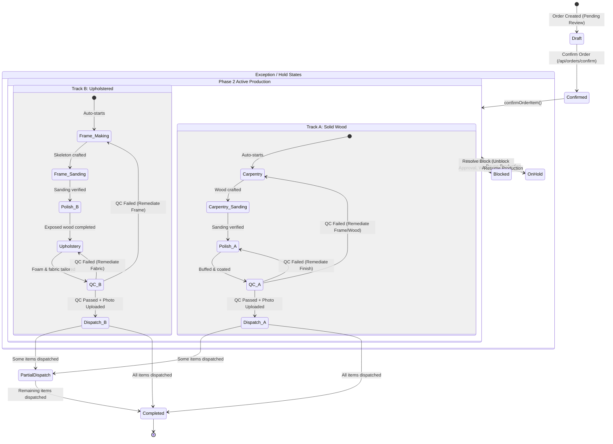
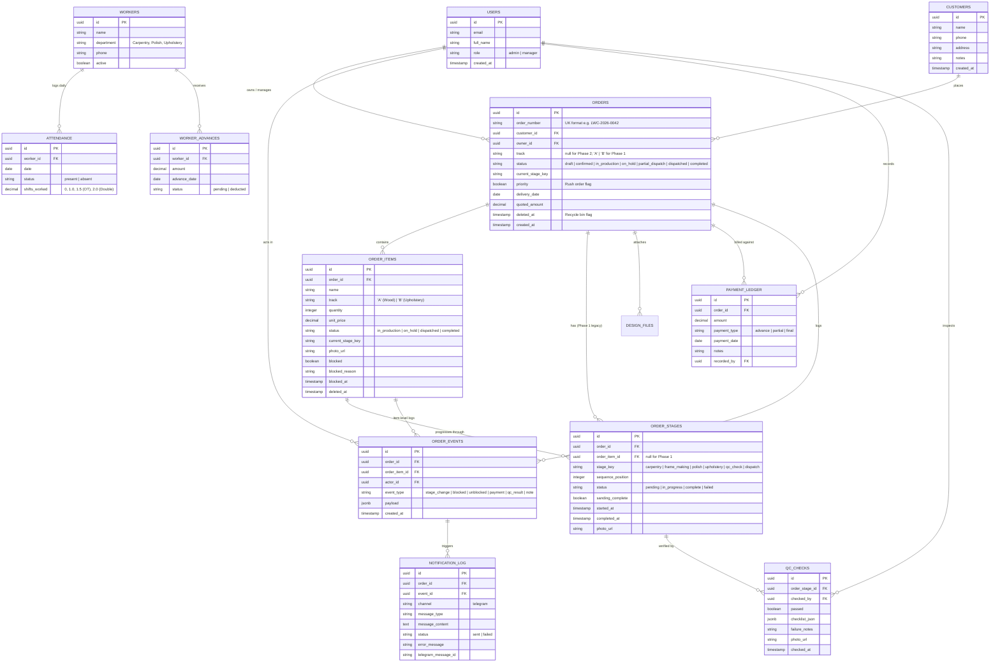

# LWC Furniture Manufacturing: AI-First Architecture & System Cartography

> **Single Source of Truth** for AI agents, engineering models, and developers working on the Laxmi Wood Craft (LWC) Workshop Operations & Enterprise Resource Platform.
> Last Updated: 2026-11-23

---

## 1. Executive Summary & Tech Stack

LWC is a specialized production management and workshop execution system tailored for bespoke custom furniture manufacturing. The platform orchestrates dual-track production lifecycles (Solid Wood vs. Upholstered Furniture), workshop floor worker attendance, stage-gated quality control, customer payment ledgers, and real-time Telegram notifications.

### Core Technology Stack
- **Web Framework**: Next.js 14.2.35 (App Router, Server Components, Route Handlers)
- **Runtime**: Node.js 20+ / Vercel Serverless Platform
- **Database & Auth**: Supabase PostgreSQL 15+ (Row Level Security, Auth Cookies, Custom Audit Triggers)
- **Object Storage**: Supabase Storage (Bucket: `design-files` for CAD/drawings, item renders, and QC verification photos)
- **State Management & Data Fetching**: TanStack Query v5 (React Query with optimistic mutations and background invalidation)
- **UI & Design System**: Tailwind CSS v3.4, Radix UI primitives (`@radix-ui/react-label`, `react-slot`, `react-switch`), Lucide Icons, Sonner Toasts
- **Real-Time Notifications**: Telegram Bot API (HTML message templates with retry queue and audit logs)
- **Language**: TypeScript 5 (Strict mode)

---

## 2. Layer 1: Bird's-Eye System Mindmap



---

## 3. Layer 2: Directory & Subsystem Ownership Matrix

| Directory / Subsystem | Primary Role & Responsibility | Core Entry Points | Downstream Callers |
| :--- | :--- | :--- | :--- |
| `src/app/(auth)/` | Authentication routes and session initialization | `login/page.tsx` | Supabase GoTrue Auth, `src/middleware.ts` |
| `src/app/(dashboard)/` | Authenticated application views (Kanban, Orders, Workers, QC, Finance, Admin) | `dashboard/page.tsx`, `orders/page.tsx`, `kanban/page.tsx` | End-users, Workshop managers, Supervisors |
| `src/app/api/` | 30+ REST API route handlers managing orders, stages, workers, attendance, and QC | `orders/route.ts`, `kanban/route.ts`, `qc/route.ts` | `src/hooks/`, Client components, TanStack Query |
| `src/app/print/` | Print-optimized views for physical order production job cards | `print/items/[itemId]/page.tsx` | Workshop floor physical cards |
| `src/components/kanban/` | Visual drag/stage cards, aging alerts, blocked overlays, and stage advance CTA | `KanbanCard.tsx`, `KanbanSkeleton.tsx` | `src/app/(dashboard)/dashboard/kanban/page.tsx` |
| `src/components/orders/` | Order creation, detail viewer, item cards, stage timelines, and ledger modal | `OrderDetailView.tsx`, `OrderItemCard.tsx`, `FsmControls.tsx` | `src/app/(dashboard)/dashboard/orders/` |
| `src/components/qc/` | Workshop floor quality control checklist form and instant image preview | `QcChecklistForm.tsx` | `dashboard/orders/[id]/qc/page.tsx` |
| `src/components/workers/` | Worker management modal and attendance roster controls | `WorkerAttendanceModal.tsx` | `dashboard/workers/page.tsx` |
| `src/components/layout/` | Application navigation, responsive sidebar, topbar, and mobile drawer nav | `Sidebar.tsx`, `Topbar.tsx`, `MobileNav.tsx` | `(dashboard)/layout.tsx` |
| `src/components/ui/` | Reusable design system primitives (Button, Dialog, BottomSheet, CelebrationOverlay) | `button.tsx`, `dialog.tsx`, `bottom-sheet.tsx`, `CelebrationOverlay.tsx` | All application components |
| `src/hooks/` | TanStack Query custom hooks encapsulating API fetch/mutate logic | `useOrders.ts`, `useOrderItems.ts`, `useKanban.ts`, `useWorkers.ts` | Presentation components |
| `src/lib/fsm/` | Finite State Machine engine enforcing stage progression, sanding, and sendbacks | `engine.ts`, `tracks.ts` | `/api/orders/[id]/advance`, `/api/order-items/[id]/advance` |
| `src/lib/notifications/`| Telegram notification orchestrator, HTML templates, and delivery logger | `send.ts`, `telegram.ts`, `templates.ts` | `src/lib/events.ts` |
| `src/lib/supabase/` | SSR, client, server, and service-role Supabase clients with actor attribution | `client.ts`, `server.ts`, `service.ts`, `middleware.ts` | API routes, middleware, FSM engine |
| `src/lib/design-constants.ts` | Immutable stage colors, stage labels with icons, and status badges | `STAGE_COLORS`, `STAGE_LABELS`, `STATUS_CONFIG` | UI cards, Kanban headers, Telegram templates |
| `supabase/migrations/` | 30 sequential SQL migrations defining schema, constraints, triggers, and RLS | `001_users_and_auth.sql` through `030_notification_infrastructure.sql` | Supabase Postgres DB |
| `types/` | Central TypeScript interfaces and domain type contracts | `index.ts` | Entire codebase |

---

## 4. Layer 3: Critical Data Flows & Lifecycles

### Lifecycle A: Order Item Stage Advancement & FSM Guard Execution



---

### Lifecycle B: Quality Control (QC) Inspection & Remediation Loop



---

### Lifecycle C: Dual-Track Production State Machine



---

## 5. Layer 4: Entity Relationships & Relational Schema



---

## 6. Layer 5: Non-Negotiable Invariants & Guardrails

### 1. FSM Sanding Invariant
- **Rule**: No stage can transition from `carpentry` (Track A) or `frame_making` (Track B) unless `sanding_complete === true`.
- **Enforcement**: Built directly into `src/lib/fsm/engine.ts` (`advanceStage` and `advanceOrderItem`). Bypassing this via raw DB updates is strictly forbidden as it violates factory quality standards.

### 2. QC Inspection Gate & Proof of Craft
- **Rule**: A stage cannot advance from `qc_check` to `dispatch` without a passing record in `qc_checks` that includes a verified `photo_url`.
- **Enforcement**: Validated in `advanceStage()` and `advanceOrderItem()`. If QC fails, the item is systematically demoted to a previous craft stage via `sendBackToStage()`, which automatically resets `sanding_complete` to `false`.

### 3. Phase 1 vs Phase 2 Separation
- **Phase 1 (Legacy)**: Single-item orders where `orders.track` is `'A'` or `'B'`, and `order_stages.order_item_id` is `null`.
- **Phase 2 (Multi-Item Canonical)**: `orders.track` is `NULL`. Individual items live in `order_items`, each having its own `track` (`'A'` or `'B'`) and linked `order_stages`. Order-level status is dynamically derived via `recalculateOrderStatus()`.
- **Guardrail**: Never assume `orders.track` is non-null. Always check `order.order_items?.length > 0` before rendering UI or mutating stages.

### 4. Next.js API Route Execution Mode (`force-dynamic`)
- **Rule**: Every API route handler that imports `createClient()` from `@/lib/supabase/server` **MUST** explicitly export:
  ```typescript
  export const dynamic = "force-dynamic";
  ```
- **Rationale**: Reading cookies/headers during static optimization triggers Next.js `DYNAMIC_SERVER_USAGE` errors, which break production builds on Vercel if caught in generic try/catch blocks.

### 5. Git Synchronization Protocol (Mandatory CLI Standard)
- **Rule**: Never run raw `git push`, `git add`, or `git commit`. Always execute:
  ```powershell
  powershell -ExecutionPolicy Bypass -File .\sync-git.ps1 "feat/fix: descriptive message"
  ```
  *(or `git sync "message"` via the configured Git alias)*.
- **Rationale**: `sync-git.ps1` atomically stages all files, commits on `main`, checks credentials, fast-forward merges into `dev`, and pushes both branches to GitHub in lockstep.

### 6. Service Role & Actor Audit Attribution
- **Rule**: Background engines (FSM, cron, event loggers) must use `createServiceRoleClient(actorId)` passing the active user's ID:
  ```typescript
  const supabase = createServiceRoleClient(actorId);
  ```
- **Rationale**: The database trigger `process_audit_log()` captures `x-user-id` from request headers to correctly attribute audit logs even when using service-role credentials.

### 7. Mobile-First Workshop Ergonomics (Anti-Friction)
- **Touch Targets**: All actionable buttons, inputs, and toggles must maintain a minimum touch target size of **44×44px** (Fitts's Law).
- **iOS Safari Auto-Zoom**: All text inputs must specify at least `text-base` (16px) font size to prevent mobile browser viewport auto-zooming.
- **Non-Blocking Feedback**: Native `window.alert()` and `window.confirm()` are completely banned in production; all feedback must use Sonner toasts (`toast.success()`, `toast.error()`) and tactile vibration via `triggerHaptic()`.

---

## 7. Environment Variables Reference

| Variable | Scope | Required | Purpose & Description |
| :--- | :--- | :---: | :--- |
| `NEXT_PUBLIC_SUPABASE_URL` | Public (Client & Server) | Yes | Supabase Project URL (`https://xyz.supabase.co`) |
| `NEXT_PUBLIC_SUPABASE_ANON_KEY` | Public (Client & Server) | Yes | Supabase Anonymous Client Key (governed by RLS) |
| `SUPABASE_SERVICE_ROLE_KEY` | Private (Server-only) | Yes | Supabase Secret Key (bypasses RLS for FSM transitions and audit logs) |
| `TELEGRAM_BOT_TOKEN` | Private (Server-only) | Optional | Telegram Bot API Token from @BotFather for push notifications |
| `TELEGRAM_CHAT_ID` | Private (Server-only) | Optional | Target Telegram Group / Channel ID for factory alerts |
| `NEXT_PUBLIC_APP_URL` | Public (Client & Server) | Optional | Canonical deployed web URL (e.g. `https://lwc-chi.vercel.app`) for deep links |

---

## 8. Development & Operational Commands

```powershell
# Install dependencies
npm install

# Run local development server
npm run dev

# Run type checking across entire codebase
npx tsc --noEmit

# Run Next.js linting
npm run lint

# Compile production bundle
npm run build

# Synchronize, commit, and push main + dev branches
powershell -ExecutionPolicy Bypass -File .\sync-git.ps1 "chore: update documentation"
```
