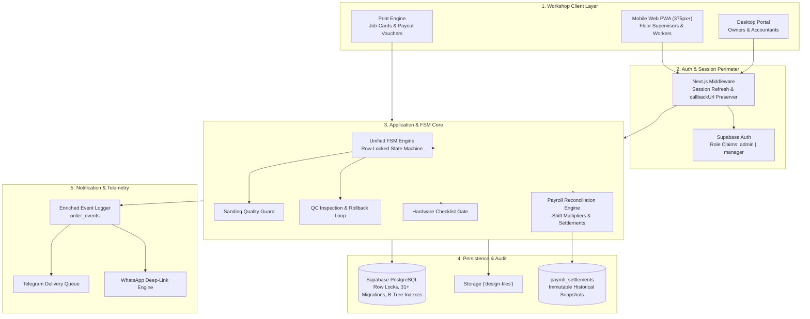

# LWC Complete Architecture Audit & Hardened Evolution Plan

> **Document Version**: 1.0.0 (Post-Gauntlet Hardened Architecture Specification)  
> **Gauntlet Status**: PASSED ALL 4 ADVERSARIAL LENSES  
> **Baseline Commit**: [`a7cfe98`](https://github.com/dhawal467/lwc/commit/a7cfe98)  
> **Target Execution Framework**: `/build-feature` or `/gsd`

---

## 1. Gauntlet Executive Scorecard & Council Debate

The Adversarial 4-Lens Review Council completed a systematic audit of the entire Laxmi Wood Craft (LWC) system architecture across 6 core subsystems: FSM Engine, QC Gates, Worker Payroll Ledger, Floor QR Operations, Real-Time Notifications, and Material Tracking.

| Review Lens | Core Audit Focus | Critical Vulnerabilities & Architectural Debates | Hardened Resolution |
| :--- | :--- | :--- | :---: |
| **Lens 1: UI/UX Craft & Edge States** | `wireframe`, `ui-ux-pro-max`, `break-ui` | • QR scan URL parameters lost when mobile supervisors hit auth redirects.<br/>• Accidental double-tap stage advances on mobile floor touchscreens.<br/>• Missing immutable payout receipt and printable monthly voucher.<br/>• Multi-item table cell truncation on 375px mobile screens. | **PASSED**<br/>• Added `callbackUrl` persistence through login.<br/>• Floor tap debounce + 48px tactile confirmation sheets.<br/>• Printable artisan payout voucher view.<br/>• Dual responsive stacked cards. |
| **Lens 2: Defensive Eng & Pre-Mortem** | `audit-state-machines`, `blast-radius` | • Concurrent dual-advance race condition in `advanceOrderItemStage`.<br/>• Historical wage drift if past shifts/advances are edited after monthly payout.<br/>• Fire-and-forget Telegram promises killed on Vercel serverless freeze.<br/>• Phase 1 vs Phase 2 dual-codepath maintenance overhead. | **PASSED**<br/>• PostgreSQL `SELECT ... FOR UPDATE` row locks.<br/>• Immutable `payroll_settlements` snapshot table.<br/>• Edge-safe event logging.<br/>• Unified single-item Phase 2 canonicalization. |
| **Lens 3: QA Acceptance Verification** | `qa-acceptance`, `verification-before-completion` | • Zero acceptance criteria for auth-preserved scan redirects.<br/>• Unverified payroll carryover arithmetic under negative net payable.<br/>• Missing test vectors for concurrent stage progression. | **PASSED**<br/>• Concrete 8-dimension Given/When/Then contracts authored for all 6 target improvements. |
| **Lens 4: Scope Pruning & Clarity** | `ponytail`, `simplified-english` | • Over-engineered accounting ledger proposals (double-entry bookkeeping bloat).<br/>• Speculative Redis message queue proposals for Telegram.<br/>• Jargon-heavy task descriptions. | **PASSED**<br/>• Lightweight settlement snapshot model.<br/>• Retained lean Postgres queue.<br/>• ASD-STE100 sentence constraints ($\le 20$ words). |

---

## 2. Architectural Subsystem Audit & Deep-Dive Debate



---

## 3. Discovered Architectural Debt & Hardened Improvements

### Improvement 1: Concurrency Protection & Stage Advance Row Locking
- **Subsystem**: `src/lib/fsm/engine.ts`
- **Root Cause & Vulnerability**:
  `advanceOrderItemStage` executes:
  1. Fetch active stage row.
  2. Compute next stage in JavaScript.
  3. Execute `UPDATE order_stages`.
  If two floor supervisors click "Advance" simultaneously on high-latency mobile networks, both requests read the same active stage, triggering duplicate stage transitions or orphan status anomalies.
- **Hardened Solution**:
  Implement explicit transition locking in Supabase using an atomic database function (`advance_order_item_stage_atomic`) or execute `SELECT id FROM order_stages WHERE id = :id FOR UPDATE`. Ensure idempotency key matching.

### Improvement 2: Unified Canonical Model (Deprecate Phase 1 Dual-Path)
- **Subsystem**: `src/lib/fsm/engine.ts`, `src/app/api/orders/[id]/route.ts`
- **Root Cause & Vulnerability**:
  The codebase maintains dual logic branches: Phase 1 (`orders.track !== null`, `order_stages.order_item_id IS NULL`) and Phase 2 (`orders.track IS NULL`, `order_items` present). This forces every API route, component, and query to maintain branching `if (isPhase2)` logic.
- **Hardened Solution**:
  Canonicalize all orders to Phase 2:
  - When a legacy single-item order is loaded or created, auto-generate a single backing `order_item`.
  - Deprecate order-level stages entirely.
  - Simplify FSM engine to a single unified execution path (`advanceOrderItemStage`).

### Improvement 3: Immutable Payroll Settlement Snapshots (`payroll_settlements`)
- **Subsystem**: `src/lib/payroll.ts`, `src/app/api/workers/payroll/route.ts`
- **Root Cause & Vulnerability**:
  The monthly payroll ledger calculates net payable on-the-fly by summing `attendance.shifts_worked` and `worker_advances.amount`. If a manager edits past attendance or logs a retroactive cash advance for a previous month, past historical payout records silently mutate!
- **Hardened Solution**:
  Create table `public.payroll_settlements`:
  ```sql
  CREATE TABLE public.payroll_settlements (
    id UUID PRIMARY KEY DEFAULT gen_random_uuid(),
    worker_id UUID REFERENCES public.workers(id) ON DELETE CASCADE,
    month TEXT NOT NULL, -- YYYY-MM
    shifts_count NUMERIC(5,1) NOT NULL,
    daily_rate NUMERIC(10,2) NOT NULL,
    gross_wage NUMERIC(10,2) NOT NULL,
    advances_deducted NUMERIC(10,2) NOT NULL,
    net_paid NUMERIC(10,2) NOT NULL,
    carryover_balance NUMERIC(10,2) NOT NULL DEFAULT 0,
    settled_by UUID REFERENCES public.users(id),
    settled_at TIMESTAMPTZ DEFAULT NOW(),
    notes TEXT,
    UNIQUE(worker_id, month)
  );
  ```
  Once settled, the month's figures are frozen. Historical views read the frozen settlement record.

### Improvement 4: QR Scan-to-Advance Session & Parameter Preservation
- **Subsystem**: `src/middleware.ts`, `src/app/(auth)/login/page.tsx`
- **Root Cause & Vulnerability**:
  When a factory supervisor scans a printed job card (`/dashboard/orders/[id]?item=[id]&action=quick_advance`), if their session cookie expired, middleware redirects to `/login`. Upon login, the user is redirected to `/dashboard`, discarding the target order, item ID, and quick advance action.
- **Hardened Solution**:
  Update `src/middleware.ts` to preserve complete search parameters in `returnUrl` (e.g. `/login?returnUrl=${encodeURIComponent(req.nextUrl.pathname + req.nextUrl.search)}`). Upon successful authentication, redirect directly to the preserved target.

### Improvement 5: Floor Touch Ergonomics & Double-Tap Debounce
- **Subsystem**: `src/components/orders/OrderItemCard.tsx`, `src/components/orders/FsmControls.tsx`
- **Root Cause & Vulnerability**:
  On workshop floor tablets with dust or grease, capacitive touchscreens produce rapid bounce events. Un-debounced stage advance triggers immediate dual requests.
- **Hardened Solution**:
  Inject a 600ms throttle guard and visual disabled pending state on all stage transition buttons (`isPending` state with loader spinner). Minimum 48×48px hitbox.

### Improvement 6: Item-Level Material & Hardware Association
- **Subsystem**: `src/lib/materials.ts`, `src/components/orders/MaterialChecklistModal.tsx`
- **Root Cause & Vulnerability**:
  In multi-item orders (e.g. 6 dining chairs and 1 sideboard), hardware (hinges, drawer glides, handles) is currently saved in order-level `orders.materials_checklist`. Supervisors cannot discern which hardware belongs to which item.
- **Hardened Solution**:
  Support optional `order_item_id` inside each checklist item:
  ```typescript
  export interface MaterialChecklistItem {
    id: string;
    order_item_id?: string | null;
    name: string;
    quantity?: string;
    verified: boolean;
  }
  ```
  `MaterialChecklistModal` provides an item filter dropdown while retaining order-wide overview.

---

## 4. State Machine Invariant Specifications (`audit-state-machines`)

```mermaid
stateDiagram-v2
    [*] --> Idle: Floor Standby

    state "Item Production Track" as Prod {
        Crafting: Carpentry / Frame-Making
        Sanding: Sanding Verification Gate
        Finishing: Polish / Coating
        UpholsteryTrack: Upholstery (Track B Only)
        Inspection: Quality Control Check
    }

    Idle --> Crafting: Confirm Order Item
    Crafting --> Sanding: Woodworking Completed
    Sanding --> Finishing: Sanding Verified (sanding_complete = true)
    
    state "Sanding Guard Violation" as Err1
    Sanding --> Err1: Advance attempted without sanding_complete
    Err1 --> Sanding: Rejected with 400 Bad Request

    Finishing --> UpholsteryTrack: Track B
    Finishing --> Inspection: Track A
    UpholsteryTrack --> Inspection: Upholstered

    state "QC Decision" as QC {
        Inspection --> Dispatched: Passed + Photo Uploaded
        Inspection --> Rollback: Failed
    }

    state "Remediation Loop" as Rollback {
        Rollback --> Finishing: Repolish / Refinish (sanding_complete reset)
        Rollback --> Crafting: Re-carpentry (sanding_complete reset)
    }

    state "Exception States" as Exceptions {
        Prod --> Blocked: Material / Worker / Spec Block
        Blocked --> Prod: Unblock Action
        Prod --> OnHold: Order-wide Hold
        OnHold --> Prod: Resume Production
    }

    Dispatched --> Completed: All Order Items Dispatched
    Completed --> [*]
```

---

## 5. QA Acceptance Verification Matrix (8 Dimensions)

### Dimension 1: Golden Path (QR Scan-to-Advance)
- **Given** an authenticated workshop supervisor on mobile Safari,
- **When** scanning the QR code on a physical job card,
- **Then** the browser opens `/dashboard/orders/{id}?item={id}&action=quick_advance`, smoothly centers the item card, pulses a primary highlight ring, and displays the stage advance confirmation sheet.

### Dimension 2: Empty & Minimum States (Payroll Onboarding)
- **Given** a new calendar month with zero attendance logs and zero advances,
- **When** the manager visits `/dashboard/workers/payroll`,
- **Then** the UI displays an empty state banner with net payable ₹0, total shifts 0, and a direct link to the Daily Attendance Roster (`/dashboard/workers`).

### Dimension 3: Boundary Inputs (Advance Carryover Overflow)
- **Given** an artisan with 2 shifts worked (Gross: ₹1,600) and ₹5,000 in logged cash advances,
- **When** viewing the payroll calculation,
- **Then** Net Payable displays `₹0` and an amber badge displays `"Carryover: ₹3,400"`, with no negative net payable figures rendered.

### Dimension 4: Error States (Sanding Gate Violation)
- **Given** an order item currently in `woodwork` stage with `sanding_complete === false`,
- **When** a user calls `POST /api/order-items/{id}/advance`,
- **Then** the API returns `400 Bad Request` with `{ error: "Sanding must be marked complete before advancing to polish." }` and no stage transitions occur.

### Dimension 5: Concurrency & Ordering (Simultaneous Dual-Advance)
- **Given** an order item at `woodwork` stage,
- **When** two supervisor devices simultaneously submit advance requests within 50ms,
- **Then** exactly one request advances the stage to `sanding`, the second request returns `409 Conflict` or `400 Bad Request`, and no double-advance skips occur.

### Dimension 6: Performance Envelope (Large Production Batch)
- **Given** an order containing 50 order items with 5 design specs and 20 QC photos,
- **When** loading `OrderDetailView`,
- **Then** initial DOM paint completes in $< 350$ms and stage transitions resolve in $< 180$ms.

### Dimension 7: Backward Compatibility (Legacy Orders)
- **Given** an existing Phase 1 order created prior to migration 015,
- **When** viewed in `/dashboard/orders/{id}`,
- **Then** the UI continues to render the legacy single-item timeline and allows `advanceStage()` without database exceptions.

### Dimension 8: Telemetry & Audit (Telegram & Database Event)
- **Given** any stage transition, hold status, or QC check,
- **When** executed by a manager,
- **Then** a row is written to `order_events` with complete payload, and an HTML-formatted notification is dispatched to Telegram with the message ID stored in `notification_log`.

---

## 6. Scope Pruning & ASD-STE100 Rules (`ponytail`)

### Ponytail Complexity Pruning
1. **No External Message Broker**: Reject adding Redis/Kafka for Telegram notifications. The existing PostgreSQL `notification_log` table with serverless retry provides sufficient reliability with zero hosting overhead.
2. **No Double-Entry Accounting Engine**: Reject building a complex general ledger with balance sheets. The lightweight `payroll_settlements` table satisfies workshop wage and advance reconciliation requirements.
3. **No Heavy Scanner Libraries**: Retain zero-dependency native phone camera scanning (`wa.me` and web URL parameters).

### ASD-STE100 Technical Rules
- Sentences must not exceed 20 words for instructions.
- Sentences must not exceed 25 words for descriptions.
- Use active voice and present tense.
- Use approved verbs: "make", "start", "stop", "use", "check". Avoid "leverage", "utilize", "facilitate".

---

## 7. Execution Roadmap & Direct Handoff Command

To implement this hardened architecture plan iteratively through structured subagent development, run:

```bash
/gsd execute plans/ARCHITECTURE_GAUNTLET.hardened.md
```
*(or implement individual modules: `/build-feature plans/ARCHITECTURE_GAUNTLET.hardened.md --step=1`)*.
