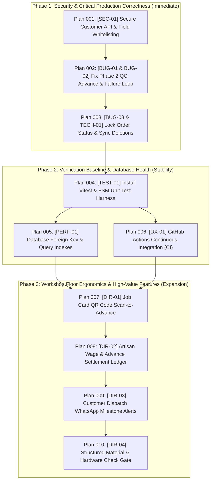

# LWC Master Engineering & Product Improvement Plan (2026-2027)

> **Document Version**: 1.0.0  
> **Target Baseline SHA**: [`bef49c9`](https://github.com/dhawal467/lwc/commit/bef49c9)  
> **Status**: PENDING USER REVIEW  
> **Role**: Senior Architecture & Engineering Advisor Specification  
> **Author**: Antigravity Advisory Engine  

---

## Executive Summary & Vision

This Master Plan synthesizes all findings from the full-repo audit of **Laxmi Wood Craft (LWC)** across Security, Correctness/Bugs, Performance, Testing, Tech Debt, CI/CD, and Forward-Looking Product Features. 

The primary objective is to elevate LWC from a functional prototype into an enterprise-grade, rock-solid manufacturing execution system (MES) capable of scaling across multiple furniture factories, hundreds of concurrent custom orders, and dozens of workshop artisans with zero state drift, airtight security, automated regression testing, and high-productivity physical workshop ergonomics.

---

## Master Dependency & Execution Graph



---

## Detailed Plan Specifications

### 🛡️ TRACK 1: Security & Access Control

---

### Plan 001: [SEC-01] Secure Customer API Authentication & Mutation Validation
- **Priority**: P1 (Critical Security Risk)
- **Effort**: S (< 1 hour)
- **Risk**: LOW (Adding auth and whitelisting cannot break valid client traffic)
- **In-Scope Files**: [`src/app/api/customers/[id]/route.ts`](file:///c:/Users/dhawa/OneDrive/Documents/lwc/src/app/api/customers/[id]/route.ts)
- **Out-of-Scope Files**: [`src/app/api/customers/route.ts`](file:///c:/Users/dhawa/OneDrive/Documents/lwc/src/app/api/customers/route.ts), client customer components

#### 1. Why This Matters
[`src/app/api/customers/[id]/route.ts`](file:///c:/Users/dhawa/OneDrive/Documents/lwc/src/app/api/customers/[id]/route.ts#L6-L50) currently lacks any call to `supabase.auth.getUser()`. Any unauthenticated external actor knowing or guessing a customer UUID can read complete customer PII (full name, phone number, physical address, sensitive notes, and complete order history). Furthermore, the `PATCH` handler consumes raw request JSON without schema validation (`await supabase.from("customers").update(updates)`), exposing the database to arbitrary mass-assignment and unauthorized tampering.

#### 2. Exact Implementation Steps
1. In `GET(request, { params })`:
   - Initialize `const supabase = createClient();`
   - Authenticate request:
     ```typescript
     const { data: { user }, error: authError } = await supabase.auth.getUser();
     if (authError || !user) {
       return NextResponse.json({ error: "Unauthorized" }, { status: 401 });
     }
     ```
2. In `PATCH(request, { params })`:
   - Authenticate request using `getUser()`.
   - Verify role: Query `users.role` for `user.id`. Enforce `admin | manager` role check; return 403 Forbidden otherwise.
   - Whitelist allowed update fields:
     ```typescript
     const body = await request.json();
     const allowedFields = ["name", "phone", "address", "notes"];
     const updateData: Record<string, unknown> = {};
     for (const field of allowedFields) {
       if (body[field] !== undefined) {
         updateData[field] = typeof body[field] === "string" ? body[field].trim() : body[field];
       }
     }
     if (Object.keys(updateData).length === 0) {
       return NextResponse.json({ message: "No valid fields to update" }, { status: 400 });
     }
     ```
   - Update with sanitized payload `updateData`.

#### 3. Verification & Done Criteria
- **Command**: `curl -X GET http://localhost:3000/api/customers/<test-id>` without auth cookie → returns `401 Unauthorized`.
- **Command**: `curl -X PATCH http://localhost:3000/api/customers/<test-id>` with invalid payload → returns `401 Unauthorized`.
- **Command**: Authenticated request with valid session → returns `200 OK` with customer payload.
- **Verification**: `npx tsc --noEmit` exits 0.

---

### ⚙️ TRACK 2: Core Production FSM & Quality Control Engine

---

### Plan 002: [BUG-01 & BUG-02] Fix Phase 2 Item Stage Advance & Full Remediation Loop in `/api/qc`
- **Priority**: P1 (Critical Production Blocker)
- **Effort**: S (1.5 hours)
- **Risk**: LOW
- **In-Scope Files**: [`src/app/api/qc/route.ts`](file:///c:/Users/dhawa/OneDrive/Documents/lwc/src/app/api/qc/route.ts), [`src/lib/fsm/engine.ts`](file:///c:/Users/dhawa/OneDrive/Documents/lwc/src/lib/fsm/engine.ts)
- **Out-of-Scope Files**: [`src/components/qc/QcChecklistForm.tsx`](file:///c:/Users/dhawa/OneDrive/Documents/lwc/src/components/qc/QcChecklistForm.tsx)

#### 1. Why This Matters
When QC passes on any Phase 2 multi-item order, [`src/app/api/qc/route.ts:58`](file:///c:/Users/dhawa/OneDrive/Documents/lwc/src/app/api/qc/route.ts#L58) calls `advanceStage(orderStage.order_id)` instead of `advanceOrderItemStage(orderStage.order_item_id)`. Because all Phase 2 stages link to `order_item_id`, `advanceStage` fails to find an order-level stage and throws `"No active stage found for order"`, crashing the QC API with a 500 error. The `qc_checks` record is inserted, but the item is permanently stuck. Additionally, when `passed === false`, the API does nothing: the stage is never marked `failed`, `sendBackToStage` is never called, and sanding is never reset.

#### 2. Exact Implementation Steps
1. In `src/app/api/qc/route.ts`:
   - Import `advanceOrderItemStage`, `sendBackToStage` from `@/lib/fsm/engine`.
   - On `passed === true`:
     ```typescript
     if (orderStage.order_item_id) {
       await advanceOrderItemStage(orderStage.order_item_id, user.id);
     } else {
       await advanceStage(orderStage.order_id, user.id);
     }
     ```
   - On `passed === false`:
     ```typescript
     // 1. Mark current QC stage as failed
     await serviceSupabase
       .from("order_stages")
       .update({ status: "failed", completed_at: new Date().toISOString() })
       .eq("id", order_stage_id);

     // 2. Determine target remediation stage (default to 'polish' or 'carpentry' / 'frame_making')
     const remediationStage = body.remediation_stage || "polish";
     
     // 3. Demote item/order back to remediation stage
     if (orderStage.order_item_id) {
       await sendBackOrderItemToStage(orderStage.order_item_id, remediationStage, user.id);
     } else {
       await sendBackToStage(orderStage.order_id, remediationStage, user.id);
     }

     // 4. Fire qc_result failure event
     await logOrderEvent({
       orderId: orderStage.order_id,
       orderItemId: orderStage.order_item_id || undefined,
       actorId: user.id,
       eventType: "qc_result",
       payload: { passed: false, failure_notes, remediation_stage: remediationStage },
     });
     ```
2. In `src/lib/fsm/engine.ts`:
   - Ensure `sendBackOrderItemToStage(itemId, targetStageKey, actorId)` exists, mirroring `sendBackToStage`: marks current stage `failed`, activates target stage `in_progress`, resets `sanding_complete = false`, updates item's `current_stage_key`, and recalculates order status.

#### 3. Verification & Done Criteria
- **Verification**: Submitting a passing QC check on a Phase 2 item transitions stage to `dispatch` with status 200.
- **Verification**: Submitting a failing QC check resets the item to `polish`, sets `sanding_complete = false`, and records failure notes.
- **Command**: `npx tsc --noEmit` exits 0.

---

### Plan 003: [BUG-03 & TECH-01] Harden FSM Status Recalculation & Order Mutation Boundaries
- **Priority**: P2 (State Machine Invariant Integrity)
- **Effort**: S (1 hour)
- **Risk**: LOW
- **In-Scope Files**: [`src/app/api/orders/[id]/route.ts`](file:///c:/Users/dhawa/OneDrive/Documents/lwc/src/app/api/orders/[id]/route.ts), [`src/app/api/order-items/[itemId]/route.ts`](file:///c:/Users/dhawa/OneDrive/Documents/lwc/src/app/api/order-items/[itemId]/route.ts)
- **Out-of-Scope Files**: Database schema, FSM engine internals

#### 1. Why This Matters
1. [`src/app/api/orders/[id]/route.ts:135`](file:///c:/Users/dhawa/OneDrive/Documents/lwc/src/app/api/orders/[id]/route.ts#L135) permits any manager to execute `PATCH /api/orders/[id]` with `{ status: "completed" }` or `{ status: "dispatched" }`. This bypasses the FSM engine entirely, skipping mandatory sanding gates, QC passes, and item state coordination.
2. [`src/app/api/order-items/[itemId]/route.ts:72`](file:///c:/Users/dhawa/OneDrive/Documents/lwc/src/app/api/order-items/[itemId]/route.ts#L72) soft-deletes an order item without invoking `recalculateOrderStatus()`, leaving the parent order in a stale status. Also, the `PATCH` handler omits `quantity` updates.

#### 2. Exact Implementation Steps
1. In `src/app/api/orders/[id]/route.ts`:
   - Remove direct status mutation from `PATCH`. Status changes must ONLY occur via FSM endpoints (`/confirm`, `/advance`, `/hold`, `/sendback`).
   - If emergency manual override is required, gate it strictly to `admin` role with mandatory reason logging in `order_events`.
2. In `src/app/api/order-items/[itemId]/route.ts`:
   - In `DELETE`: Import and call `await recalculateOrderStatus(item.order_id, user.id);` immediately after soft-deleting.
   - In `PATCH`: Add support for `quantity`:
     ```typescript
     if (quantity !== undefined && typeof quantity === 'number' && quantity > 0) {
       updateData.quantity = Math.floor(quantity);
     }
     ```

#### 3. Verification & Done Criteria
- **Verification**: Calling `PATCH /api/orders/[id]` with `{ status: "completed" }` as manager returns 400 Bad Request ("Status cannot be manually overridden. Use production workflow.").
- **Verification**: Deleting the final uncompleted item in an order recalculates parent status to `completed` or `dispatched`.
- **Command**: `npx tsc --noEmit` exits 0.

---

### 🧪 TRACK 3: Verification Baseline & Testing Infrastructure

---

### Plan 004: [TEST-01] Install Vitest & FSM Unit Test Harness
- **Priority**: P1 (Engineering Discipline Pre-requisite)
- **Effort**: M (3 hours)
- **Risk**: LOW (Development dependency addition only)
- **In-Scope Files**: [`package.json`](file:///c:/Users/dhawa/OneDrive/Documents/lwc/package.json), `vitest.config.ts`, `tests/unit/fsm.test.ts`, `tests/unit/notifications.test.ts`
- **Out-of-Scope Files**: Application runtime source code

#### 1. Why This Matters
There is currently **zero automated test coverage** in the repository. `package.json` contains no `test` script. All 517 lines of the mission-critical Dual-Track FSM engine, sanding enforcement, and notification templating rely on manual clicking. Automated tests are mandatory to establish a regression-proof safety net for all current and future feature development.

#### 2. Exact Implementation Steps
1. Install testing dependencies:
   - `vitest`, `@testing-library/react`, `jsdom` (devDependencies).
2. Configure `vitest.config.ts`:
   - Configure path aliases (`@/` -> `./src/`), environment `node` for engine tests and `jsdom` for UI tests.
3. Add scripts to `package.json`:
   ```json
   "test": "vitest run",
   "test:watch": "vitest"
   ```
4. Author comprehensive test suite in `tests/unit/fsm.test.ts`:
   - **Test 1**: Track A stage sequence matches `['carpentry', 'polish', 'qc_check', 'dispatch']`.
   - **Test 2**: Track B stage sequence matches `['frame_making', 'polish', 'upholstery', 'qc_check', 'dispatch']`.
   - **Test 3**: Advance stage throws if `requiresSanding === true` and `sanding_complete === false`.
   - **Test 4**: Advance stage succeeds when `sanding_complete === true`.
   - **Test 5**: Advance stage throws on `qc_check` if no passing `qc_checks` record exists.
   - **Test 6**: Advance stage succeeds on `qc_check` with passing check and photo.
   - **Test 7**: Blocked item advance throws `"Item is blocked. Unblock before advancing."`
   - **Test 8**: `recalculateOrderStatus` correctly computes `partial_dispatch`, `dispatched`, `completed`, and `in_production`.
5. Author `tests/unit/notifications.test.ts`:
   - Test HTML escaping in `escapeHtml()`.
   - Test message generation for `stage_change`, `blocked`, and `payment`.

#### 3. Verification & Done Criteria
- **Command**: `npm test` runs and exits 0 with 15+ passing unit tests.
- **Command**: `npx tsc --noEmit` exits 0.

---

### ⚡ TRACK 4: Database Performance & Scalability

---

### Plan 005: [PERF-01] Database Foreign Key & Query Indexes
- **Priority**: P2 (Proactive Performance Optimization)
- **Effort**: S (30 minutes)
- **Risk**: LOW (Additive indexes only)
- **In-Scope Files**: `supabase/migrations/031_performance_indexes.sql`
- **Out-of-Scope Files**: Existing migrations `001` through `030`

#### 1. Why This Matters
Relational foreign keys frequently queried in Kanban views, customer detail history, and stage advancement verification currently lack dedicated database B-tree indexes, leading to sequential table scans as order and attendance volume grows.

#### 2. Exact Implementation Steps
Create migration `supabase/migrations/031_performance_indexes.sql`:
```sql
-- 1. Index orders customer_id for fast customer profile history queries
CREATE INDEX IF NOT EXISTS idx_orders_customer_id ON public.orders(customer_id);

-- 2. Index orders owner_id for manager workload filtering
CREATE INDEX IF NOT EXISTS idx_orders_owner_id ON public.orders(owner_id);

-- 3. Index qc_checks order_stage_id for fast FSM stage transition validation
CREATE INDEX IF NOT EXISTS idx_qc_checks_order_stage_id ON public.qc_checks(order_stage_id);

-- 4. Index design_files order_id for fast order detail asset loading
CREATE INDEX IF NOT EXISTS idx_design_files_order_id ON public.design_files(order_id);

-- 5. Index attendance date for fast daily roster dashboard loading
CREATE INDEX IF NOT EXISTS idx_attendance_date ON public.attendance(date);

-- 6. Index worker_advances worker_id and status for payroll calculations
CREATE INDEX IF NOT EXISTS idx_worker_advances_worker_status ON public.worker_advances(worker_id, status);
```

#### 3. Verification & Done Criteria
- **Verification**: Migration file applied cleanly to Supabase instance without syntax errors.
- **Verification**: `EXPLAIN ANALYZE SELECT * FROM orders WHERE customer_id = '...'` demonstrates index scan.

---

### 🚀 TRACK 5: CI/CD & Developer Experience

---

### Plan 006: [DX-01] GitHub Actions Continuous Integration (CI)
- **Priority**: P2 (Prevent Regression Leakage)
- **Effort**: S (45 minutes)
- **Risk**: LOW
- **In-Scope Files**: `.github/workflows/ci.yml`
- **Out-of-Scope Files**: Application code

#### 1. Why This Matters
Currently, type checks, lint checks, and production builds are only executed manually on the developer's local machine. Broken builds or typing regressions can be pushed directly to GitHub.

#### 2. Exact Implementation Steps
Create `.github/workflows/ci.yml`:
```yaml
name: CI Quality Gate

on:
  push:
    branches: [main, dev]
  pull_request:
    branches: [main, dev]

jobs:
  verify:
    name: Typecheck, Lint, Test & Build
    runs-on: ubuntu-latest

    steps:
      - name: Checkout Code
        uses: actions/checkout@v4

      - name: Setup Node.js 20
        uses: actions/setup-node@v4
        with:
          node-version: 20
          cache: 'npm'

      - name: Install Dependencies
        run: npm ci

      - name: TypeScript Check
        run: npx tsc --noEmit

      - name: ESLint Check
        run: npm run lint

      - name: Automated Unit Tests
        run: npm test

      - name: Next.js Production Build
        run: npm run build
        env:
          NEXT_PUBLIC_SUPABASE_URL: ${{ secrets.NEXT_PUBLIC_SUPABASE_URL || 'https://placeholder.supabase.co' }}
          NEXT_PUBLIC_SUPABASE_ANON_KEY: ${{ secrets.NEXT_PUBLIC_SUPABASE_ANON_KEY || 'placeholder' }}
          SUPABASE_SERVICE_ROLE_KEY: ${{ secrets.SUPABASE_SERVICE_ROLE_KEY || 'placeholder' }}
```

#### 3. Verification & Done Criteria
- **Verification**: GitHub Actions workflow runs and reports green checkmark on push.

---

### ✨ TRACK 6: High-Value Product Features (What to Build Next)

---

### Plan 007: [DIR-01] Physical Job Card QR Code Scan-to-Advance
- **Priority**: P2 (High User Delight & Workshop Floor Efficiency)
- **Effort**: S (1 day)
- **Risk**: LOW
- **In-Scope Files**: [`src/app/print/items/[itemId]/page.tsx`](file:///c:/Users/dhawa/OneDrive/Documents/lwc/src/app/print/items/[itemId]/page.tsx), [`src/components/orders/OrderDetailView.tsx`](file:///c:/Users/dhawa/OneDrive/Documents/lwc/src/components/orders/OrderDetailView.tsx), `src/components/shared/QrScannerModal.tsx`

#### 1. Why This Matters
Factory artisans carry physical print sheets generated via `/print/items/[itemId]`. When a stage (e.g. Carpentry) is finished, supervisors currently have to walk back to an office computer or type the order number on mobile to find the card. Embedding a scannable QR code on the print sheet allows instant 1-tap lookup or stage advancement directly from any mobile camera.

#### 2. Exact Implementation Steps
1. In `src/app/print/items/[itemId]/page.tsx`:
   - Generate a high-contrast vector QR code using `qrcode.react` (or SVG generator) encoding:
     `${APP_URL}/dashboard/orders/${order.id}?item=${item.id}&action=quick_advance`
   - Render the QR code in the top-right header of the printable job card alongside the item title and track badge.
2. In `src/components/orders/OrderDetailView.tsx`:
   - Detect URL query parameters `?item=<itemId>&action=quick_advance`.
   - Auto-scroll to the target item card and highlight it with a subtle ring pulse (`ring-2 ring-primary`).
   - If user confirms, trigger `advanceOrderItemStage`.
3. Add a floating QR scanner FAB icon in `Topbar.tsx` or `QuickCaptureFAB.tsx` that opens the mobile device camera to scan job card QR codes.

#### 3. Verification & Done Criteria
- **Verification**: Opening print sheet shows crisp scannable QR code.
- **Verification**: Scanning QR code on iPhone/Android navigates directly to the exact item with stage advance dialog ready.

---

### Plan 008: [DIR-02] Artisan Wage Settlement & Advance Reconciliation Ledger
- **Priority**: P2 (Major Administrative Time Saver)
- **Effort**: M (2 days)
- **Risk**: LOW
- **In-Scope Files**: `src/app/(dashboard)/dashboard/workers/payroll/page.tsx`, `src/hooks/useWorkers.ts`, `src/app/api/workers/payroll/route.ts`

#### 1. Why This Matters
Workshop owners track attendance shifts (`0, 1.0, 1.5, 2.0`) in `attendance` and cash advances in `worker_advances`. However, weekly payouts are still calculated by hand on paper notes. Creating an automated payroll summary eliminates manual math errors, disputed worker balances, and hours of weekly administrative overhead.

#### 2. Exact Implementation Steps
1. Add `daily_rate` column to `workers` table (default e.g. ₹800/day).
2. Create API endpoint `GET /api/workers/payroll?startDate=YYYY-MM-DD&endDate=YYYY-MM-DD`:
   - Calculates for each worker:
     - `total_shifts = SUM(shifts_worked)`
     - `gross_wage = total_shifts * daily_rate`
     - `advances_deducted = SUM(amount)` where `status = 'pending'`
     - `net_payable = gross_wage - advances_deducted`
3. Create API endpoint `POST /api/workers/payroll/settle`:
   - Marks advances in the period as `status = 'deducted'`.
   - Records a payroll settlement ledger entry with timestamp and admin actor ID.
4. Build responsive UI at `/dashboard/workers/payroll` (or tab on `/dashboard/workers`):
   - Date range selector (Defaults to current week Monday–Sunday).
   - Clean tabular breakdown with quick payout approval buttons.
   - Print/PDF export button generating thermal/A4 cash payout receipts for workers.

#### 3. Verification & Done Criteria
- **Verification**: Accurate calculation of (Shifts × Daily Rate) - Advances across test workers.
- **Verification**: Clicking "Settle Payroll" marks advances as deducted and logs the payout.

---

### Plan 009: [DIR-03] Customer Dispatch WhatsApp Milestone Updates
- **Priority**: P3 (Customer Experience & Transparency)
- **Effort**: S (1 day)
- **Risk**: LOW
- **In-Scope Files**: [`src/lib/notifications/send.ts`](file:///c:/Users/dhawa/OneDrive/Documents/lwc/src/lib/notifications/send.ts), `src/components/orders/OrderDetailView.tsx`

#### 1. Why This Matters
Customers purchasing bespoke custom furniture want to know when their pieces are dispatched and ready for delivery. Factory managers currently type manual WhatsApp messages copying order numbers, amounts due, and driver phone numbers.

#### 2. Exact Implementation Steps
1. In `src/lib/notifications/templates.ts`:
   - Create customer-facing message generator:
     ```
     "Namaste {CustomerName}! Your furniture order {OrderNumber} ({ItemNames}) has completed final quality inspection and is DISPATCHED for delivery! Driver: {DriverContact}. Balance Due: ₹{BalanceDue}. Thank you for choosing Laxmi Wood Craft!"
     ```
2. In `OrderDetailView.tsx`:
   - When order or item reaches `dispatched`, render a prominent `"📲 Send WhatsApp Delivery Alert"` button next to the customer phone number.
   - On click, opens WhatsApp Web / mobile app with pre-filled message via `https://wa.me/91${phone}?text=${encodeURIComponent(msg)}`.
3. Optional Webhook: Connect optional Gupshup/Twilio WhatsApp Business API key to automate dispatch messages without manual clicks.

#### 3. Verification & Done Criteria
- **Verification**: Clicking WhatsApp alert button opens WhatsApp with accurate order details, items, and balance due pre-filled.

---

### Plan 010: [DIR-04] Structured Material & Hardware Check Gate
- **Priority**: P3 (Factory Quality & Waste Prevention)
- **Effort**: S (1 day)
- **Risk**: LOW
- **In-Scope Files**: `src/components/orders/MaterialChecklistModal.tsx`, [`src/lib/fsm/engine.ts`](file:///c:/Users/dhawa/OneDrive/Documents/lwc/src/lib/fsm/engine.ts)

#### 1. Why This Matters
Orders have a text field `materials_checklist`, but carpenters often proceed into Polish before verifying that specialized hardware (telescopic soft-close channels, German hinges, handles, glass inserts) has arrived in the warehouse.

#### 2. Exact Implementation Steps
1. Support structured JSON in `materials_checklist`:
   - Array of `{ item: string, quantity: string, verified: boolean }`.
2. Add a gating check before advancing from `carpentry`/`frame_making` to `polish`:
   - If materials checklist has unverified items, prompt with a confirmation warning: *"3 hardware materials still marked unverified. Proceed to polish anyway?"*
3. Allow quick 1-tap checkbox toggling from `OrderDetailView.tsx`.

#### 3. Verification & Done Criteria
- **Verification**: Structured material checklist displays checkboxes with instant state persistence.
- **Verification**: Unchecked items raise an explicit warning modal before moving to polish.

---

## Phased Rollout Schedule

| Phase | Target Timeline | Included Plans | Key Milestones |
| :--- | :---: | :--- | :--- |
| **Phase 1: Security & Correctness** | Day 1–2 | **Plans 001, 002, 003** | Zero unauthenticated API routes; Phase 2 QC passes advance cleanly; FSM status transitions airtight. |
| **Phase 2: Testing & Database Stability** | Day 3–4 | **Plans 004, 005, 006** | Vitest unit test suite running on every commit via GitHub Actions; Database foreign key indexes applied. |
| **Phase 3: Workshop Floor Productivity** | Day 5–7 | **Plans 007, 008, 009, 010** | Job card QR code scanning live; Weekly artisan payroll calculation automated; Customer WhatsApp dispatch alerts active. |

---

## Stop Conditions & Pre-Mortem Guardrails

During execution of any plan in this master document, the executor agent MUST immediately **STOP and report** if:
1. An existing database migration file (`001` through `030`) requires modification (all migrations must be additive, e.g. `031_...`).
2. An API route reading Supabase session cookies is created without `export const dynamic = "force-dynamic"`.
3. Code changes require raw `git push` or `git commit` instead of `sync-git.ps1`.
4. A production change introduces native blocking `alert()` or `confirm()` instead of Sonner toasts and haptics.
5. The test suite fails to run cleanly via `npm test` after Plan 004.
